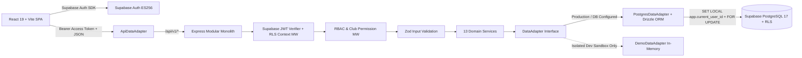

# CampusVerse

Centralized college clubs, events, registrations, single-use QR attendance, and institutional reporting platform.

> **Phase 2 Status**: Production PostgreSQL persistence (`PostgresDataAdapter` + Drizzle ORM across 17 normalized tables), database privilege separation (`campusverse_app` with Row-Level Security), pessimistic transactional locking for concurrency invariants, and Supabase Auth JWT verification (`ES256`/`RS256` JWKS + institutional email domain checks) are implemented and verified.

---

## Architecture Overview



## Technology Stack

- **Frontend**: React 19, TypeScript, Vite 8, Tailwind CSS 4, React Router 7, TanStack Query, React Hook Form, Zod, Lucide React, `qrcode.react`, `@supabase/supabase-js` (Auth only)
- **Backend**: Node.js 22, Express 4, TypeScript (`tsx`), Helmet, CORS, Express Rate Limit, Zod
- **Database & Auth**: Supabase PostgreSQL 17, Drizzle ORM (`drizzle-orm`, `drizzle-kit`, `postgres` driver with `prepare: false` for Supavisor pooling), Row-Level Security (RLS), Supabase Auth (`ES256` JWKS)
- **PWA**: `vite-plugin-pwa`, Workbox (`NetworkOnly` for `/api/*`, offline app shell caching)
- **Testing**: Vitest, Supertest, Testing Library, Playwright, Live PostgreSQL concurrency & RLS integration tests

## Folder Structure

```text
├── drizzle/                    # Generated SQL migrations (0000_*.sql + meta journal)
├── public/                     # PWA icons (SVG, PNG 192/512/maskable, apple-touch-icon)
├── shared/                     # Shared constants, TypeScript DTOs, Zod schemas
├── server/
│   ├── adapters/               # DataAdapter interface, PostgresDataAdapter, DemoDataAdapter
│   ├── config/                 # Environment validation & business constants
│   ├── db/                     # Drizzle schema (17 tables), connection pool, RLS SQL, migrations/seed/status scripts, repositories/
│   ├── middleware/             # Supabase JWT Auth + RLS AsyncLocalStorage context, RBAC/club-scoped Authz, Zod validation, rate limit
│   ├── modules/                # 13 modular monolith domain modules
│   ├── shared/                 # AppError hierarchy, JSON response helpers, crypto & Supabase JWKS verifier
│   └── app.ts                  # Express app factory (/health + /health/ready + /api/v1/*)
├── server.ts                   # Port 3000 dev (Vite middleware) & prod static server (fails fast if DATABASE_URL missing in prod)
├── src/
│   ├── adapters/               # ClientDataAdapter, ApiDataAdapter
│   ├── components/             # Layout shell, route guards, UI primitives, PWA components
│   ├── context/                # AuthContext (Supabase Auth + server session hydration), ToastContext
│   ├── lib/                    # Singleton browser Supabase Auth client
│   └── pages/                  # Public/Auth, Student, Club Admin, Core Member, Super Admin
├── tests/
│   ├── backend/                # Supertest API tests & live PostgreSQL concurrency/RLS integration tests
│   ├── frontend/               # React Testing Library component tests
│   └── e2e/                    # Playwright end-to-end workflows
└── docs/                       # Architecture, database, security, development, API contracts, and ADRs
```

## Database & Migrations

```bash
npm run db:generate  # Generate Drizzle SQL migrations from server/db/schema.ts
npm run db:migrate   # Apply pending SQL migrations using DATABASE_MIGRATION_URL
npm run db:rls       # Apply RLS policies, integrity triggers, and campusverse_app least-privilege role
npm run db:seed      # Idempotent institutional catalog & system_settings seed
npm run db:status    # Inspect applied migrations, table row counts, RLS status, and runtime role flags
```

## Running & Verification Commands

```bash
npm install
npm run dev          # Starts Express + Vite middleware on http://localhost:3000
npm run lint         # TypeScript typechecking (tsc --noEmit)
npm run build        # Production Vite + PWA bundle
npm test             # Vitest unit, component, and live PostgreSQL integration tests
npm run test:e2e     # Playwright end-to-end tests
```
