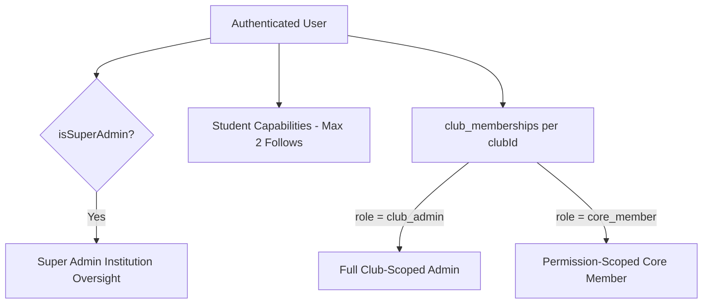

# Authorization & Multi-Club Context Model

CampusVerse models roles as **contextual memberships**, not mutually exclusive global roles.

## Business Rules Enforced in Phase 1 vs Phase 2

| Rule | Phase 1 Enforcement | Phase 2 Database Enforcement |
| :--- | :--- | :--- |
| Max 2 followed clubs | `DemoDataAdapter.followClub` | Transaction + PostgreSQL trigger |
| Multi-club memberships | `club_memberships` array per `clubId` | `UNIQUE(user_id, club_id)` + RLS |
| Club Admin club-scoped | `requireClubAdmin('clubId')` | PostgreSQL RLS policy on `club_id` |
| Core Member permission-scoped | `requireEventPermission` | RLS + permission JSONB check |
| Financial data hidden from students | `SUBMIT_FINANCE_REPORTS` / Super Admin only | RLS blocking student SELECT on `financial_reports` |
| Single-use QR attendance | `recordAttendance` conflict check | `UNIQUE(registration_id)` on `attendance_records` |
